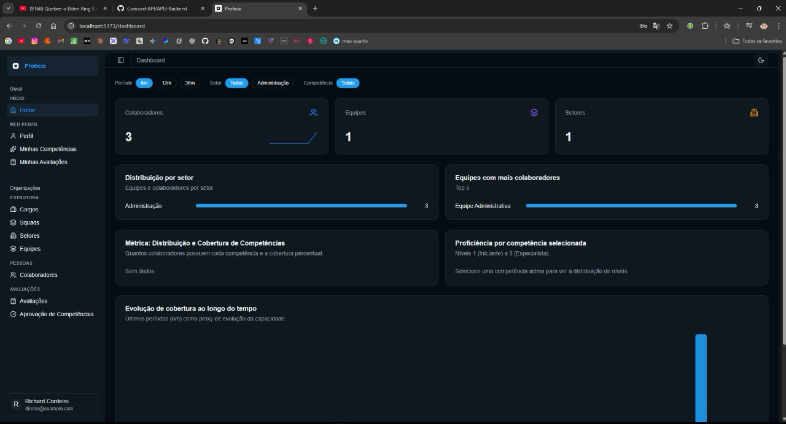

<h2>Sobre mim</h2>


<p align="center"></p>

Meu nome é Victor Nogueira, sou estudante de Banco de Dados na FATEC São José dos Campos e atualmente estou no quinto semestre do curso.

Meu primeiro contato com programação aconteceu em 2022, durante uma oportunidade como Jovem Aprendiz na Embraer, onde dei meus primeiros passos na área de tecnologia e decidi seguir essa carreira.

Desde então, venho desenvolvendo minhas habilidades em desenvolvimento full stack, com foco principal no frontend, criando interfaces organizadas e integradas a APIs e bancos de dados.

Atualmente, faço estágio de desenvolvimento na DM, empresa do ramo de crédito, trabalhando principalmente com Python e SQL. Além disso, estudo e pratico tecnologias como TypeScript, React, Vue.js e Java, buscando evoluir tanto na construção de interfaces quanto na implementação de regras de negócio no backend.

## Contatos
* [GitHub](https://github.com/victorgsnogueira)
* [LinkedIn](https://www.linkedin.com/in/victorgsnogueira/)

## Meus Principais Conhecimentos

**Aplicações e dados**


## Meus Projetos

### Em 2024-2 | API 1º semestre — Calculadora Científica

### Empresa Parceira: FATEC São José dos Campos (projeto interno)

**Papel na equipe:** Desenvolvedor

### Problema:
O primeiro semestre tinha como desafio construir uma solução computacional simples, com foco em algoritmos e lógica de programação. A proposta era reunir, em uma interface de texto parecida com uma calculadora científica, várias operações matemáticas que obrigassem a equipe a aplicar estruturas de decisão, repetição, funções e validação de entrada.

### Solução Entregue pela Equipe:
A equipe desenvolveu uma calculadora científica em Portugol, executada no Visualg, com um menu que permite ao usuário escolher a operação e realizar várias operações na mesma execução. Além das quatro operações básicas, a calculadora resolve fatorial, função de segundo grau, juros simples e compostos, concatenação de strings e conversões entre as bases decimal, binária, octal e hexadecimal. O trabalho foi organizado em três sprints, cada uma com um arquivo de entrega próprio.

[Repositório do Projeto](https://github.com/RichardCordeiro/API-Concord)

#### Principais Funcionalidades

- Menu de escolha das operações, com várias operações por execução.
- Operações básicas: adição, subtração, multiplicação e divisão.
- Cálculo de fatorial e de função de segundo grau.
- Juros simples e juros compostos.
- Concatenação de duas strings.
- Conversão de bases: B10 ↔ B2, B2 ↔ B8 e B2 ↔ B16.

#### Tecnologias Utilizadas

> - **Portugol / Visualg**: Linguagem e ambiente usados para escrever e executar os algoritmos da calculadora.
> - **Git e GitHub**: Utilizados para versionamento, organização das entregas por sprint e colaboração da equipe.

#### Contribuições Pessoais

<details>
  <summary>Cálculo de juros simples e compostos</summary>
  <br>

```
procedimento cjuros()
var
   x, y, z, montante: real
inicio
   escreval("Entre com o Capital inicial: ")
   leia(x)
   escreval("Entre com a taxa aplicada de juros compostos(em %): ")
   leia(y)
   escreval("Entre com o quantidade de vezes que os juros serao aplicados: ")
   leia(z)

   montante <- x * ((1+(y/100))^z)
   escreval("o total do montante:", montante)
fimprocedimento
```

  Desenvolvi, na segunda sprint, os procedimentos de juros simples e juros compostos e os incluí no menu principal da calculadora como as opções 8 e 9. O juros simples calcula o montante a partir do capital, da taxa anual e do tempo, e o juros composto aplica a taxa sobre o capital pela quantidade de períodos informada.
</details>

<details>
  <summary>Documentação do projeto</summary>
  <br>
  Atualizei o README do repositório com as novas funcionalidades entregues, adicionei a seção de integrantes do grupo com as fotos da equipe e ajustei a logo do projeto.
</details>

#### Hard Skills

- **Lógica de programação**: Sei fazer com autonomia
- **Portugol / Visualg**: Sei fazer com autonomia
- **Git/GitHub**: Sei fazer com autonomia

#### Soft Skills

**Comunicação**: Mantive o diálogo com os colegas para integrar minhas funções ao arquivo de entrega da sprint sem quebrar o que já existia.

**Organização**: Documentei as funcionalidades e os integrantes no README, deixando claro o que cada entrega trazia.

**Proatividade**: Assumi a documentação do repositório além da parte de código, para que o projeto ficasse apresentável na entrega.

### Em 2025-1 | API 2º semestre — Concord Grid Manager

### Empresa Parceira: FATEC São José dos Campos (projeto interno)

**Papel na equipe:** Desenvolvedor

### Problema:
A montagem da grade de horários de um semestre era feita manualmente. Cada disciplina tem uma quantidade obrigatória de aulas por semana, cada curso posiciona suas aulas de um jeito e o mesmo professor não pode estar em duas aulas no mesmo horário. Sem uma ferramenta própria, o coordenador precisava conferir tudo à mão, o que tornava o processo lento e sujeito a conflitos de horário.

### Solução Entregue pela Equipe:
A equipe desenvolveu o Concord Grid Manager, uma aplicação desktop para gerenciar a grade de horários de aula. O sistema permite cadastrar cursos, disciplinas, professores, turmas e horários, montar a grade da semana, ajustá-la manualmente antes de confirmar e visualizá-la de forma organizada. Ao agendar ou editar uma aula, o sistema verifica automaticamente se o professor já tem outra aula naquele dia e horário e avisa sobre o conflito. O projeto foi entregue em três sprints e incluiu guia de instalação e manual de uso.

[Repositório do Projeto](https://github.com/Concord-API/API-2)

#### Principais Funcionalidades

- Cadastro, edição e exclusão de cursos, disciplinas, professores, turmas e horários.
- Montagem e visualização da grade semanal de aulas.
- Ajustes manuais na grade antes da confirmação.
- Aviso automático de conflito quando um professor é colocado em duas aulas no mesmo horário.
- Gerenciamento do semestre, vinculando disciplinas e horários ao período.

#### Tecnologias Utilizadas

<p align="center">
  <a href="https://skillicons.dev">
    
  </a>
</p>

> - **Java**: Utilizado no desenvolvimento de toda a aplicação.
> - **JavaFX e Scene Builder**: Utilizados na construção das telas da aplicação desktop.
> - **Maven**: Utilizado no gerenciamento de dependências e do build.
> - **MySQL**: Utilizado para armazenar cursos, professores, disciplinas e aulas.
> - **IntelliJ IDEA**: Ambiente de desenvolvimento.
> - **Git e GitHub**: Utilizados para versionamento e colaboração.

#### Contribuições Pessoais

<details>
  <summary>Migração do SQLite para o MySQL</summary>
  <br>
  Fiz a troca do banco de dados do projeto de SQLite para MySQL e criei o script <code>concord.sql</code> com a estrutura das tabelas. Depois, adicionei novos scripts SQL com os dados iniciais, corrigi o script e ajustei os nomes das colunas e as classes de aula para ficarem de acordo com o novo banco.
</details>

<details>
  <summary>CRUD de professores e cursos</summary>
  <br>

```java
@FXML
public void showEditDialog() {
    Professor selected = table.getSelectionModel().getSelectedItem();
    if (selected != null) {
        Dialog<Professor> dialog = createProfessorDialog("Editar Professor", selected);
        Optional<Professor> result = dialog.showAndWait();
        result.ifPresent(updated -> {
            professorDAO.editarProfessor(updated);
            selected.setNome(updated.getNome());
            selected.setEmail(updated.getEmail());
            selected.setTelefone(updated.getTelefone());
            selected.setMatricula(updated.getMatricula());
            selected.setStatus(updated.getStatus());
            table.refresh();
        });
    }
}
```

  Criei os models e os controllers de Professor e Curso e entreguei o CRUD completo das duas telas, com cadastro, edição e exclusão feitos em diálogos que atualizam a tabela na hora. Também ajustei o controller de cadastro de aula e finalizei a tela de gerenciamento de disciplinas.
</details>

<details>
  <summary>Telas e estilização</summary>
  <br>
  Criei e alterei views do sistema, corrigi os IDs dos arquivos FXML que não batiam com os controllers e escrevi a folha de estilos principal da aplicação, padronizando a aparência das telas.
</details>

#### Hard Skills

- **Java**: Sei fazer com autonomia
- **JavaFX**: Sei fazer com autonomia
- **SQL / MySQL**: Sei fazer com autonomia
- **Git/GitHub**: Sei fazer com autonomia

#### Soft Skills

**Colaboração**: Entreguei a base de dados em MySQL cedo na sprint, o que permitiu que o restante da equipe desenvolvesse suas telas em cima do mesmo banco.

**Resolução de problemas**: Identifiquei e corrigi as divergências entre os FXML e os controllers, que impediam algumas telas de funcionar.

**Autodidatismo**: Aprendi JavaFX e a integração com MySQL durante o semestre para entregar as telas e o banco do projeto.

### Em 2025-2 | API 3º semestre — Proficio

### Empresa Parceira: [ALTAVE](https://www.altave.com.br/)

**Papel na equipe:** Desenvolvedor e revisor de código

### Problema:
A ALTAVE precisava de uma forma mais eficiente de mapear as competências de seus colaboradores. A empresa tinha dificuldade para alocar profissionais em equipes, squads ou demandas específicas porque não possuía uma visão centralizada das skills técnicas, soft skills, certificações, experiências e níveis de proficiência de cada pessoa.

Sem uma plataforma estruturada para consultar essas informações, a identificação de talentos e a organização de equipes dependiam de processos manuais, o que dificultava a tomada de decisão por parte de diretores e gestores.

### Solução Entregue pela Equipe:
A equipe desenvolveu o Proficio, uma plataforma de mapeamento de competências pensada como um "LinkedIn interno" para a empresa. A solução permite que colaboradores mantenham um perfil profissional com suas habilidades, certificações e informações relevantes, enquanto gestores e diretores conseguem visualizar dados consolidados para apoiar decisões estratégicas.

O sistema conta com controle de acesso por perfil, permitindo que colaboradores acessem suas próprias informações, gestores acompanhem dados de suas equipes e diretores visualizem dashboards, relatórios e métricas gerais. Também foram desenvolvidas funcionalidades para cadastro de usuários, gestores, colaboradores, equipes, setores, skills, avaliações, autoavaliações e filtros por competência.

Com isso, a plataforma facilita a identificação de profissionais com habilidades específicas, apoia a montagem de equipes, melhora a gestão de talentos e oferece uma visão mais clara da distribuição de competências dentro da empresa.


<a href="https://github.com/Concord-API/API-3"></a>

[Repositório do Projeto](https://github.com/Concord-API/API-3) · [Backend](https://github.com/Concord-API/API3-Backend) · [Frontend](https://github.com/Concord-API/API3-Frontend)


#### Principais Funcionalidades

- Dashboard por equipe com visualização de integrantes e distribuição de habilidades.
- Perfil individual para colaboradores com cadastro, edição e exclusão de skills.
- Controle de acesso por perfil para diretor, gestor e colaborador.
- Cadastro e listagem de gestores, colaboradores, equipes e setores.
- Dashboard com métricas de colaboradores, skills, setores e equipes.
- Avaliação de colaboradores e autoavaliação de proficiência.
- Cadastro de skills ainda não registradas no sistema.
- Filtros para busca de colaboradores por competência.

#### Tecnologias Utilizadas

<p align="center">
  <a href="https://skillicons.dev">
    
  </a>
</p>

> - **React e TypeScript**: Utilizados no desenvolvimento de todo o frontend, criado com Vite.
> - **Tailwind CSS e shadcn/ui (Radix UI)**: Utilizados na construção e estilização dos componentes e telas.
> - **MSW (Mock Service Worker)**: Utilizado para simular a API enquanto o backend ainda estava em desenvolvimento.
> - **Java e Spring Boot**: Utilizados no backend, com API REST e Spring Security.
> - **JWT**: Utilizado na autenticação e no controle de acesso por perfil.
> - **MySQL**: Utilizado para armazenamento e organização dos dados da plataforma.
> - **Docker**: Utilizado para facilitar a configuração e padronização do ambiente.
> - **Git e GitHub**: Utilizados para versionamento, colaboração e revisão de código.

#### Contribuições Pessoais

<details>
  <summary>Desenvolvimento do frontend do zero</summary>
  <br>
  Fui responsável pelo frontend da aplicação, desde a criação do projeto com Vite, React, Tailwind e shadcn/ui. Desenvolvi a tela de login e de recuperação de senha, a separação dos dashboards por cargo (diretor, gestor e colaborador), o dashboard do diretor, o perfil do colaborador com editor de avatar e capa, a tela de competências com seus modais e as telas de setores, equipes, colaboradores e cargos. Também criei o tema da aplicação com alternância entre claro e escuro, a persistência do login e o carregamento com skeleton nas listagens.
</details>

<details>
  <summary>Telas de avaliações</summary>
  <br>
  Na última sprint, desenvolvi a tela e o modal para avaliar colaboradores, a página de avaliações com filtros, a opção de avaliação pública e a tela de "Minhas Avaliações". Também implementei a filtragem de competências aprovadas em vários componentes e a lógica de aprovação nas telas iniciais do diretor e do gestor.
</details>

<details>
  <summary>Autenticação com JWT e funcionalidades do backend</summary>
  <br>
  No backend, implementei a autenticação da API com JWT e a configuração de CORS para o frontend. Também reorganizei a estrutura de pastas e repositories do projeto, criei o endpoint de cadastro de colaboradores com validações, adicionei o campo de perfil de acesso à entidade Cargo, incluí novos campos nos DTOs de colaborador e criei o endpoint que lista as avaliações feitas por um avaliador.
</details>

<details>
  <summary>Integração das sprints e revisão de código</summary>
  <br>
  Criei o repositório principal com os submódulos de backend e frontend, mantive os submódulos atualizados a cada entrega, fiz os merges das branches de sprint e revisei os Pull Requests da equipe no frontend e no backend.
</details>

#### Hard Skills

- **React**: Sei fazer com autonomia
- **TypeScript**: Sei fazer com autonomia
- **JavaScript**: Sei fazer com autonomia
- **HTML**: Sei fazer com autonomia
- **CSS**: Sei fazer com autonomia
- **Tailwind CSS**: Sei fazer com autonomia
- **Java**: Sei fazer com autonomia
- **Spring Boot**: Sei fazer com autonomia
- **MySQL**: Sei fazer com autonomia
- **Docker**: Sei fazer com autonomia
- **Git/GitHub**: Sei fazer com autonomia

#### Soft Skills

**Comunicação**: Mantive o alinhamento constante entre o frontend e o backend, combinando com a equipe os formatos dos dados e das rotas antes de cada integração.

**Colaboração**: Revisei o código dos colegas nas duas frentes do projeto e apoiei na resolução de impedimentos, mantendo o padrão do código ao longo das sprints.

**Autonomia**: Assumi o frontend inteiro e usei mocks da API para não depender do ritmo do backend, o que permitiu entregar as telas desde a primeira sprint.

### Em 2026-1 | API 4º semestre — Trivio

### Empresa Parceira: [ALTAVE](https://www.altave.com.br/)

**Papel na equipe:** Desenvolvedor e revisor de código

### Problema:
A ALTAVE precisava gerenciar manutenções de equipamentos distribuídos geograficamente, pertencentes a contratos de diferentes clientes. O planejamento das manutenções periódicas, a alocação de técnicos e o acompanhamento das intervenções dependiam de controles manuais, sem considerar de forma integrada a localização dos equipamentos, a recorrência prevista em contrato, a duração estimada e a prioridade das atividades.

### Solução Entregue pela Equipe:
A equipe desenvolveu o Trivio, uma plataforma web de gerenciamento de manutenções. O sistema permite cadastrar clientes, contratos, equipamentos e técnicos com suas competências, agendar manutenções e acompanhá-las em calendário, lista e mapa. Quando uma manutenção preventiva é concluída, a próxima é gerada automaticamente com base na recorrência do contrato. Os técnicos têm acesso próprio, com sua agenda, o histórico de execuções e notificações das manutenções próximas, e os administradores acompanham o andamento e documentam processos personalizados por contrato. O projeto foi entregue em três sprints, com a aplicação publicada online durante o semestre.

[Repositório do Projeto](https://github.com/Concord-API/API-4) · [Backend](https://github.com/Concord-API/API4-Backend) · [Frontend](https://github.com/Concord-API/API4-Frontend)

#### Principais Funcionalidades

- Cadastro e gerenciamento de clientes, contratos, equipamentos e técnicos.
- Geração automática da próxima manutenção preventiva a partir da recorrência do contrato.
- Calendário de manutenções com arrastar e redimensionar cards.
- Mapa com os locais de atendimento e as manutenções agendadas.
- Área do técnico com agenda, histórico de execução e filtros por dia ou contrato.
- Acompanhamento das manutenções com mensagens e checklist de execução.
- Documentação das manutenções e processos personalizados por contrato.

#### Tecnologias Utilizadas

<p align="center">
  <a href="https://skillicons.dev">
    
  </a>
  
</p>

> - **Vue.js e TypeScript**: Utilizados no desenvolvimento do frontend.
> - **MapLibre GL e Nominatim**: Utilizados no mapa da aplicação e na busca e geocodificação de endereços.
> - **Java e Spring Boot**: Utilizados no backend, com API REST, Spring Security e Spring Data JPA.
> - **JWT e BCrypt**: Utilizados na autenticação, no armazenamento seguro das senhas e na proteção de rotas por perfil.
> - **Oracle Database**: Banco de dados relacional da aplicação.
> - **Docker e Nginx**: Utilizados para padronizar o ambiente e publicar a aplicação em uma VPS.
> - **Git, GitHub e GitHub Projects**: Utilizados para versionamento, revisão de código e gestão das tasks.

#### Contribuições Pessoais

<details>
  <summary>Base do frontend e telas de cadastro</summary>
  <br>
  Criei o projeto do frontend em Vue.js com o layout, a sidebar, o tema e os componentes de interface. Desenvolvi as rotas, as telas e os serviços de técnicos, equipamentos, contratos, manutenções, requisitos e clientes, além do painel de detalhes. Depois, migrei os formulários de todas as telas para diálogos, adicionei botões flutuantes no mobile e corrigi a responsividade das telas com abas.
</details>

<details>
  <summary>Autenticação com JWT e proteção de rotas</summary>
  <br>

```java
String authHeader = request.getHeader("Authorization");
if (authHeader == null || !authHeader.startsWith("Bearer ")) {
    chain.doFilter(request, response);
    return;
}

String token = authHeader.substring(7);
try {
    String username = jwtUtil.extractUsername(token);
    if (username != null && SecurityContextHolder.getContext().getAuthentication() == null) {
        UserDetails userDetails = userDetailsService.loadUserByUsername(username);
        if (jwtUtil.isTokenValid(token, userDetails)) {
            UsernamePasswordAuthenticationToken auth = new UsernamePasswordAuthenticationToken(
                userDetails, null, userDetails.getAuthorities()
            );
            auth.setDetails(new WebAuthenticationDetailsSource().buildDetails(request));
            SecurityContextHolder.getContext().setAuthentication(auth);
        }
    }
} catch (JwtException | UsernameNotFoundException e) {
    log.debug("JWT authentication failed for request {}: {}", request.getRequestURI(), e.getMessage());
}

chain.doFilter(request, response);
```

  Implementei a autenticação de ponta a ponta. No backend, criei a geração e validação de tokens JWT, o filtro acima que valida o token Bearer em cada requisição, o carregamento do funcionário pelo e-mail, o hash das senhas com BCrypt, o endpoint <code>POST /auth/login</code> e a configuração do Spring Security com proteção de rotas por perfil, com a chave secreta lida de variável de ambiente. No frontend, troquei o login simulado pela chamada real, passei a enviar o token em todas as requisições, redirecionei para o login quando a sessão expira e criei a proteção de rotas por perfil.
</details>

<details>
  <summary>Agenda de manutenções em calendário</summary>
  <br>
  Desenvolvi a agenda semanal de manutenções no estilo de calendário, com a grade de horários, o mini-calendário lateral com filtro por técnico e legenda, o banner das manutenções sem horário, o menu de contexto e o popover de visualização rápida. Criei também o modal de detalhe, edição e criação em duas colunas, a detecção de colisão entre cards no mesmo horário e o arrastar e redimensionar dos cards em intervalos de 30 minutos, além da adaptação do calendário para o mobile.
</details>

<details>
  <summary>Mapa e geocodificação</summary>
  <br>
  Integrei o MapLibre GL ao projeto e criei um seletor de localização no mapa, com busca de endereço pelo Nominatim e seleção por clique, usado nos formulários de contrato, manutenção e no calendário. Os cards e modais da agenda exibem o endereço obtido por geocodificação reversa, com um endereço alternativo quando a busca falha.
</details>

<details>
  <summary>Acompanhamento e checklist de manutenções</summary>
  <br>
  Criei no backend a entidade, o service, os DTOs e o controller de acompanhamento das manutenções, validando o autor das mensagens e filtrando manutenções inativas, além das rotas para listar e atualizar parcialmente o checklist. No frontend, redesenhei o modal de manutenção com o painel de acompanhamento em formato de chat, o checklist de execução e confirmações para ações críticas.
</details>

<details>
  <summary>CRUD de requisitos, deploy e revisão de código</summary>
  <br>
  Fiz o setup inicial do backend com dev container e as APIs de cadastro, alteração e consulta de requisitos e de requisitos por contrato. Preparei o backend e o frontend com Docker e Nginx para a publicação na VPS, ajustei o CORS de produção, mantive os submódulos do repositório principal atualizados a cada sprint e revisei os Pull Requests da equipe.
</details>

#### Hard Skills

- **Vue.js**: Sei fazer com autonomia
- **TypeScript**: Sei fazer com autonomia
- **Java**: Sei fazer com autonomia
- **Spring Boot / Spring Security**: Sei fazer com autonomia
- **Oracle Database**: Sei fazer com autonomia
- **Docker**: Sei fazer com autonomia
- **Git/GitHub**: Sei fazer com autonomia

#### Soft Skills

**Visão de ponta a ponta**: Assumi funcionalidades completas, do banco à tela, como a autenticação e o acompanhamento das manutenções, o que reduziu a dependência entre backend e frontend nas entregas.

**Colaboração**: Revisei os Pull Requests da equipe e apoiei os colegas na integração das funcionalidades, mantendo um padrão consistente no código.

**Autodidatismo**: Aprendi Vue.js, Oracle, MapLibre e a publicação de aplicações com Docker e Nginx durante o semestre para atender às demandas do projeto.
